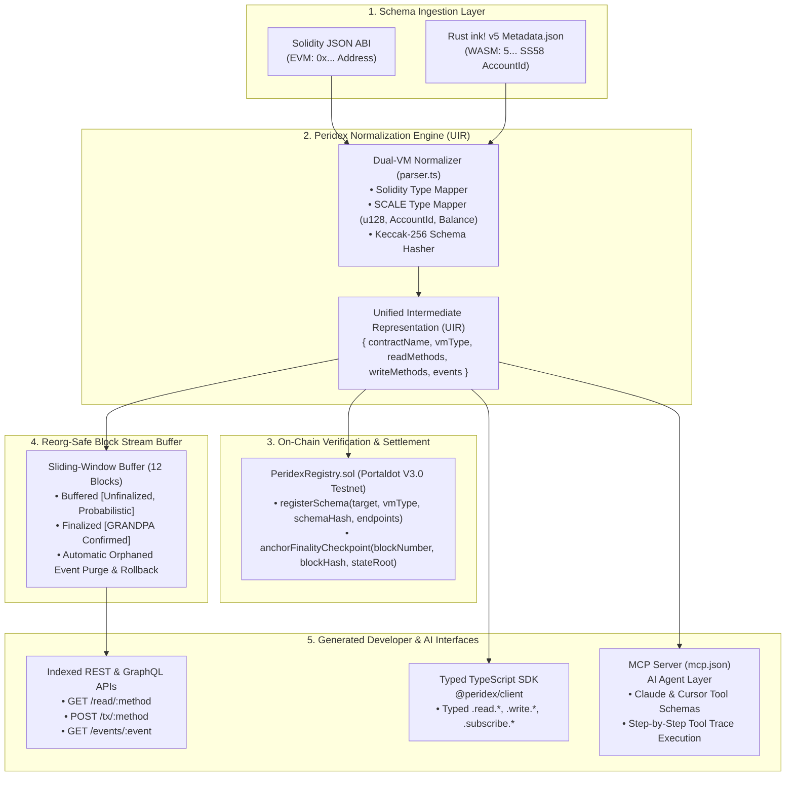

# Peridex — Dual-VM Backend-as-a-Service (BaaS) for Portaldot Network V3.0

> **"ABI in, API out"** — Unified developer middleware and AI Agent infrastructure for hybrid EVM (Solidity) and WASM (Rust `ink!`) smart contracts on Portaldot Network V3.0.

---

## 1. Problem & Vision

Portaldot Network V3.0 is a next-generation Substrate-based blockchain featuring native **Dual-VM execution**:
1. **EVM (Solidity)**: Standard `0x` addresses, Keccak-256 ABI calldata, and EVM log topics.
2. **WASM (Rust `ink! V5`)**: Substrate SS58 (`5...`) `AccountId32` addresses, SCALE-encoded messages, and pallet contract events.

### The Middleware Fragmentation Problem
Currently, developers building on Portaldot face severe middleware friction:
- **No Unified Indexing:** EVM contracts require Graph subgraphs; `ink!` contracts require Subsquid/SubQuery dictionaries. Writing apps that coordinate cross-VM logic requires managing two completely distinct indexer stacks.
- **Client SDK Overhead:** Developers must manually build Scale codec encoders for Rust types (`u128`, `AccountId`, `Balance`, `Hash`) while juggling `ethers.js`/`viem` for Solidity contracts.
- **Zero AI Agent Interoperability:** Modern autonomous agents (Claude, Cursor, custom LangChain bots) lack standardized schema definitions (Model Context Protocol / MCP) to read state or construct transactions across both VMs.
- **Probabilistic Reorg Risk:** Substrate block production creates probabilistic block confirmation before GRANDPA finality kicks in. Middleware that indexes head-of-the-chain blocks risks returning state that gets orphaned during a chain reorg.

### The Peridex Solution ("Supabase for Portaldot V3.0")
A developer pastes ANY Portaldot contract address + either a **Solidity ABI JSON** or an **`ink! V5 metadata.json`**. Peridex automatically:
1. Normalizes both formats into a **Unified Intermediate Representation (UIR)**.
2. Anchors the schema hash on-chain via [`PeridexRegistry.sol`](file:///contracts/src/PeridexRegistry.sol).
3. Instantly generates 4 live developer outputs:
   - **REST & GraphQL Endpoints:** Auto-creates cached queries for read methods (`view` in Solidity, `mutates: false` in ink!), transaction payload builders for write methods, and indexed event streams.
   - **Typed TypeScript SDK (`@peridex/client`):** Autocompleted interfaces for inputs/outputs, `.read.*`, `.write.*`, and `.subscribe.*` WebSocket listeners.
   - **Model Context Protocol (MCP) Server (`mcp.json`):** Standard tool definitions (`portaldot_read_*`, `portaldot_build_tx_*`, `portaldot_query_events_*`) enabling AI agents to read chain state and prepare unsigned transactions.
   - **Reorg-Safe Finality Buffer:** Sliding-window block buffer distinguishing `Buffered (Unfinalized)` blocks from `Finalized (GRANDPA)` blocks, automatically purging orphaned logs upon block mismatch.

---

## 2. System Architecture Diagram



---

## 3. Portaldot Network V3.0 Configuration

Peridex is pre-configured for the official Portaldot V3.0 Testnet:

| Property | Value |
| :--- | :--- |
| **Node Explorer** | [https://node-console.portaldot.dev/](https://node-console.portaldot.dev/) |
| **WebSocket Node URL** | `wss://test-node-v3.portaldot.dev` |
| **EVM RPC Endpoint** | `https://test-evm-rpc-v3.portaldot.dev` |
| **Chain ID (EVM)** | `420420777` |
| **Native POT Address Format** | Starts with `5` (Substrate SS58 format) |
| **EVM Address Format** | Starts with `0x` (Hex address format) |

---

## 4. Foundry Smart Contracts (`/contracts`)

The on-chain anchoring layer is written in Solidity `^0.8.24` and tested with Foundry.

### Contract Overview
- [`PeridexRegistry.sol`](file:///contracts/src/PeridexRegistry.sol):
  - `registerSchema(...)`: Stores schema deployment records, binds target contracts to their normalized schema hashes, and emits `SchemaRegistered`.
  - `anchorFinalityCheckpoint(...)`: Anchors finalized block checkpoints to guarantee tamper-proof reorg validation.
  - `isFinalized(...)`, `getDeployment(...)`, `getAllDeploymentIds(...)`.

### Running with WSL (Recommended)
Peridex is fully configured for Foundry inside WSL or Linux:

```bash
# 1. Compile contracts
wsl -u <user> ~/.foundry/bin/forge build --root /mnt/c/Users/PC/Desktop/Coding/Peridex/contracts

# 2. Run test suite
wsl -u <user> ~/.foundry/bin/forge test --root /mnt/c/Users/PC/Desktop/Coding/Peridex/contracts -vv

# 3. Simulate broadcast deployment to Portaldot V3.0 Testnet
wsl -u <user> ~/.foundry/bin/forge script DeployPeridexRegistry \
  --root /mnt/c/Users/PC/Desktop/Coding/Peridex/contracts \
  --rpc-url https://test-evm-rpc-v3.portaldot.dev
```

### Foundry Test Results
```
Ran 6 tests for test/PeridexRegistry.t.sol:PeridexRegistryTest
[PASS] test_AnchorFinalityCheckpoint() (gas: 181332)
[PASS] test_MultipleRegistrations() (gas: 495461)
[PASS] test_RegisterEVMSchema() (gas: 444381)
[PASS] test_RegisterInkWASMSchema() (gas: 455907)
[PASS] test_RevertOnEmptyTargetContract() (gas: 33877)
[PASS] test_RevertOnZeroSchemaHash() (gas: 33803)
Suite result: ok. 6 passed; 0 failed; 0 skipped
```

---

## 5. Web Console & Monorepo Structure

```
peridex/
├── contracts/                        # Foundry Project
│   ├── foundry.toml                  # Solc 0.8.24 & Portaldot V3.0 RPC endpoint
│   ├── src/
│   │   └── PeridexRegistry.sol       # Dual-VM schema anchor & checkpoint contract
│   ├── test/
│   │   └── PeridexRegistry.t.sol     # Unit tests verifying EVM & ink! registrations
│   └── script/
│       └── Deploy.s.sol              # Portaldot Testnet broadcast deployment script
├── src/
│   ├── app/
│   │   ├── globals.css               # Minimalist light theme tokens (#FFFFFF, #FAFAFA, #09090B)
│   │   ├── layout.tsx                # App root layout
│   │   └── page.tsx                  # Full-screen split-pane Developer Console
│   └── lib/
│       ├── types.ts                  # UIR & MCP & Reorg TypeScript definitions
│       ├── parser.ts                 # Dual-VM normalization engine (Solidity ABI & ink! v5)
│       ├── presets.ts                # ERC20PortalToken, PortalStakingInk, PeridexRegistry
│       ├── sdkGenerator.ts           # Dynamic @peridex/client TypeScript SDK generator
│       ├── mcpGenerator.ts           # Model Context Protocol (mcp.json) generator
│       └── simulator.ts              # Sliding-window reorg buffer & mock Portaldot RPC
├── package.json                      # Next.js 15, React 19, Lucide, Tailwind CSS
├── tailwind.config.ts                # Strict minimalist palette
└── README.md                         # DoraHacks Check-in documentation
```

### Running the Web Console
```bash
# Install dependencies
npm install

# Start local Next.js dev server
npm run dev

# Production build
npm run build
```

---

## 6. DoraHacks Check-in Milestone Roadmap

### Phase 1: MVP Core (Completed at Check-in)
- [x] **Dual-VM Normalization Engine (`parser.ts`):** Complete parser handling both Solidity ABI arrays and Rust `ink! V5` metadata objects into a single Unified Intermediate Representation (UIR).
- [x] **Foundry On-Chain Registry (`PeridexRegistry.sol`):** Smart contract for anchoring schema hashes and finality checkpoints on Portaldot Network V3.0. Full unit tests passing (6/6).
- [x] **Interactive Split-Pane Developer Console (`page.tsx`):**
  - Minimalist Light Theme (`#FFFFFF`, `#FAFAFA`, `#09090B`).
  - 3 Dynamic Presets (`ERC20`, `PortalStakingInk`, `PeridexRegistry`).
  - REST & GraphQL interactive tester with latency tracking.
  - Real-time `@peridex/client` TypeScript SDK generator with download & copy capabilities.
  - MCP Server generator (`mcp.json`) & Live Agent Runner with step-by-step trace breakdown.
  - Reorg buffer simulation demonstrating unfinalized block rollback and canonical branch reconciliation.

### Phase 2: Final Submission Roadmap (Nov 6 Target)
- [ ] **Live Portaldot Substrate WebSocket Indexer:** Direct connection to `wss://test-node-v3.portaldot.dev` to stream live Pallet Contracts events into an on-memory SQLite / DuckDB cache.
- [ ] **Dual-VM Calldata Signer Extension:** MetaMask (EVM) and Polkadot{.js} / SubWallet (ink! WASM) 1-click execution right from the tester.
- [ ] **Multi-Tenant MCP Server Deployment:** One-click hosted deployment of `mcp.json` endpoints to Cloudflare Workers for remote Claude Desktop integration.
